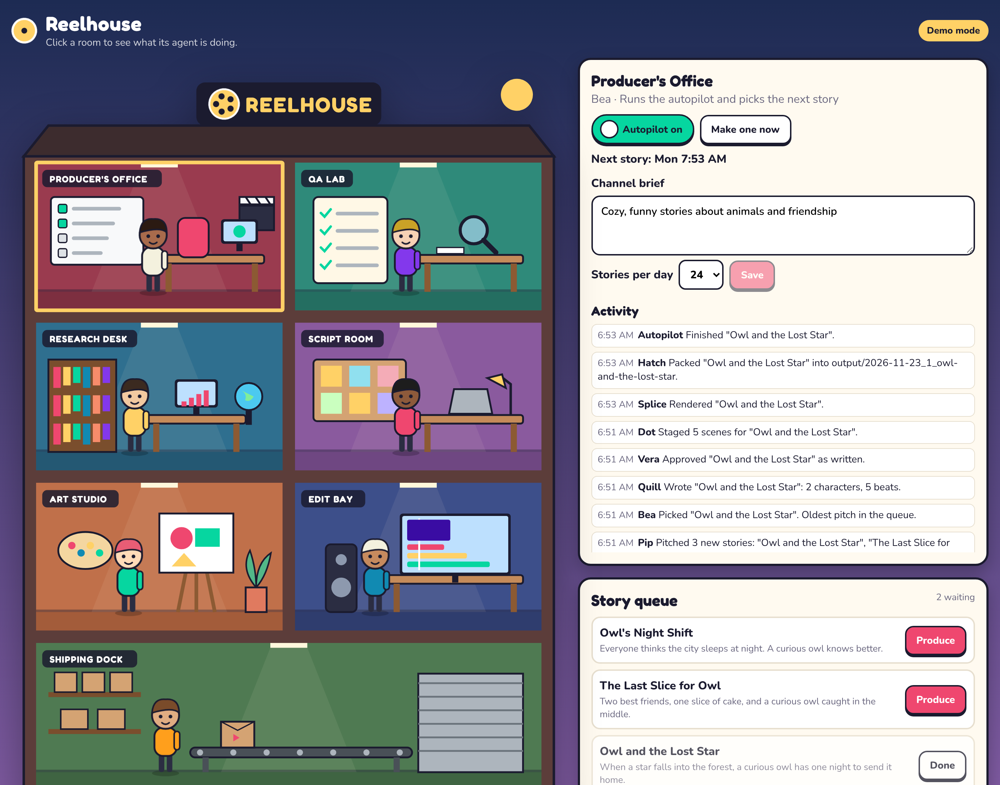
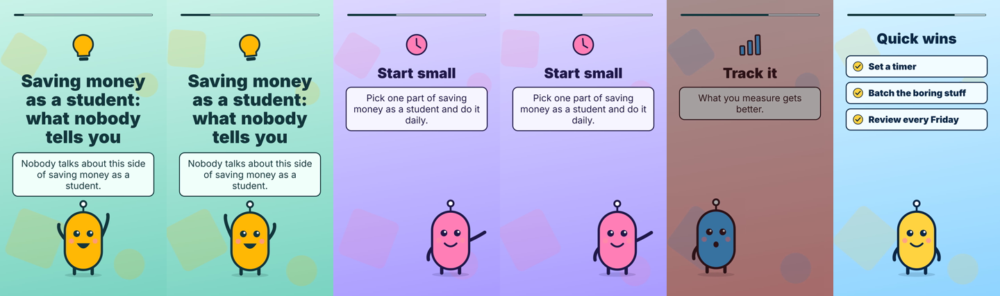
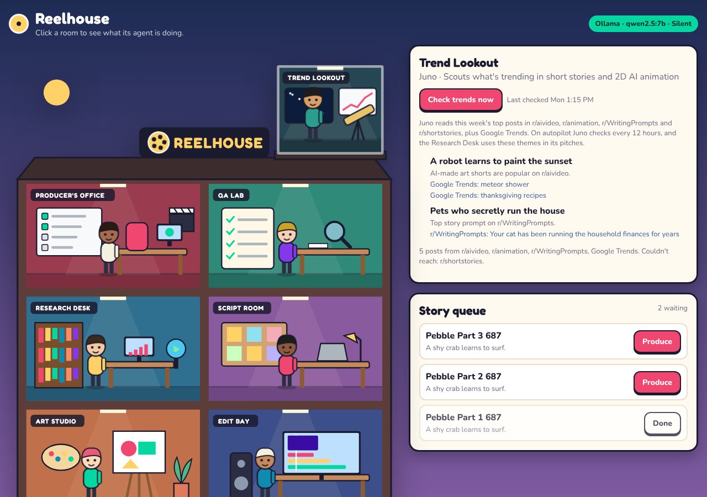

# Reelhouse

A 2D studio building where each room is an AI agent that does one real step of making a **short animated story** as a vertical video. You click a room to see what its agent is doing, give the Research Desk a theme, and press **Produce** on a story pitch to send it down the line. Out comes a 30 to 45 second 1080×1920 MP4: a title card, 2D characters acting out the story across scenes with narration and speech bubbles, a "The End" card, and a ready-to-paste post caption.



| Room | Agent | What it does |
| --- | --- | --- |
| Trend Lookout (rooftop) | Juno | Checks what's trending in short stories and 2D AI animation (top posts this week in r/aivideo, r/animation, r/WritingPrompts and r/shortstories, plus Google Trends) and turns them into story themes |
| Producer's Office | Bea | Runs the autopilot and picks the strongest waiting pitch |
| QA Lab | Vera | Checks each story before it is drawn: rule checks always, plus a Claude edit pass in live mode. Fixes what it can, rejects the rest |
| Research Desk | Pip | Turns a theme into 3 to 5 story pitches (title, logline, genre and twist) and adds them to the queue |
| Script Room | Quill | Writes the story: up to 3 characters (name, color, accessory) and 5 to 8 beats, each with a setting, time of day, narration, who is on screen with their mood and action, and an optional line of dialogue |
| Art Studio | Dot | Stages each beat: timing from reading speed, camera move, and a valid cast |
| Sound Booth | Echo | Records the narration and each character's lines with Piper, and the scenes are timed to the voices. Then adds background music that fits the story's mood (playful, tender, mystery, adventure or dreamy) and dips while someone speaks. The music is composed in code for each story, or picked from your own tracks in `music/` |
| Edit Bay | Splice | Animates the scenes with Remotion and renders the MP4 |
| Shipping Dock | Hatch | Saves each finished story to `output/<date>_<id>_<title>/` as `video.mp4`, `caption.txt` and `story.json`, and serves it for download |





## Autopilot

Open the Producer's Office, write a channel brief (for example "cozy, funny stories about animals and friendship"), pick how many stories per day, and switch autopilot on. From then on, each run:

1. Refills the queue when fewer than 3 pitches are waiting. The Trend Lookout checks its sources first (at most every 12 hours), and the Research Desk pitches from the brief plus the current trends, skipping titles the studio has already used. If no trend source can be reached, it uses the last report, or the brief alone.
2. Has the Producer pick the best pitch.
3. Writes, checks, stages, renders and exports the story.
4. Retries a failed story once right away. A story that fails twice is marked Skipped.

Runs are spread evenly across the day. Every step is logged in the Producer's Office. The scheduler starts with the server, so autopilot keeps working with no browser open, but only while `npm start` (or `npm run dev`) is running. Set `REELHOUSE_OUTPUT_DIR` to save finished stories somewhere else.

## Free and open source AI

Reelhouse runs without any paid service:

- **Ollama** writes the pitches and stories with an open model (`qwen2.5:7b` by default), on your computer.
- **Piper** records the voiceover on your computer: a narrator voice, plus a different voice for each character.
- **Claude** is optional. If you add an API key and choose it in the Producer's Office, Claude writes the stories instead (they're stronger, but cost a few cents each).
- With neither Ollama nor Claude, it falls back to **demo templates**, so the app always works.

The "Story writer" choice in the Producer's Office can be Automatic (Ollama, then Claude, then demo), Ollama, Claude or Demo.

## Run it

**Step-by-step guide for Windows and Mac: [SETUP.md](SETUP.md).** In short, with Node.js, Ollama and Python installed:

```bash
npm install
npm run setup:ollama   # downloads the story model (~4.7 GB)
npm run setup:voice    # installs Piper and two voices into .venv and ./voices
npm run build && npm start   # http://localhost:3000
```

Other scripts:

- `npm run dev` runs the app in development mode.
- `npm run studio` opens Remotion Studio to tweak the video look live.
- `npm run render:sample` renders the demo story to `data/renders/sample.mp4` without the app.
- `npm run typecheck`

A note on licenses: Ollama, Qwen 2.5 and Piper are open source. The video renderer, Remotion, is source-available and free for individuals and companies with up to 3 people, but larger companies need a [company license](https://www.remotion.dev/license).

## How it fits together

- `app/` Next.js app router: the studio page and the API (`/api/state`, `/api/ideas`, `/api/jobs`, `/api/videos/:id`).
- `components/Building.tsx` the SVG building, rooms and animated workers.
- `components/Studio.tsx` room panels and the idea queue; polls `/api/state`.
- `lib/engine.ts` picks the story writer (Ollama, Claude or demo) and asks it for structured JSON.
- `lib/agents/` the writing agents (pitches, producer pick, story, QA editor), rule-based QA, demo templates, and Art (deterministic scene timing).
- `lib/trends.ts` the Trend Lookout: free public sources (no accounts or keys), summarized into themes by the story writer.
- `lib/voice.ts` the Sound Booth: Piper voiceover.
- `lib/music.ts` background music: picks a mood, then composes a tune (chords, bass, melody, light drums) or picks one of your tracks.
- `lib/pipeline.ts` runs one job at a time: script, art, edit, ship.
- `remotion/` the story video: 8 backgrounds (forest, city, bedroom, space, beach, castle, cafe, classroom) in day, sunset and night, characters with 7 expressions and 5 actions, speech bubbles, narration, title and end cards.
- `data/` SQLite database and rendered MP4s (git-ignored).

## Not yet built

- Posting straight to TikTok, Reels or Shorts (each platform needs app approval).


